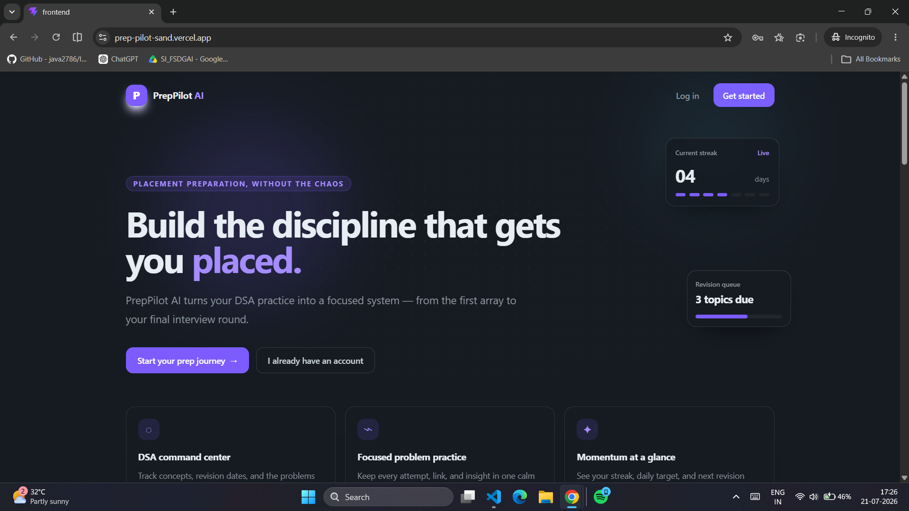
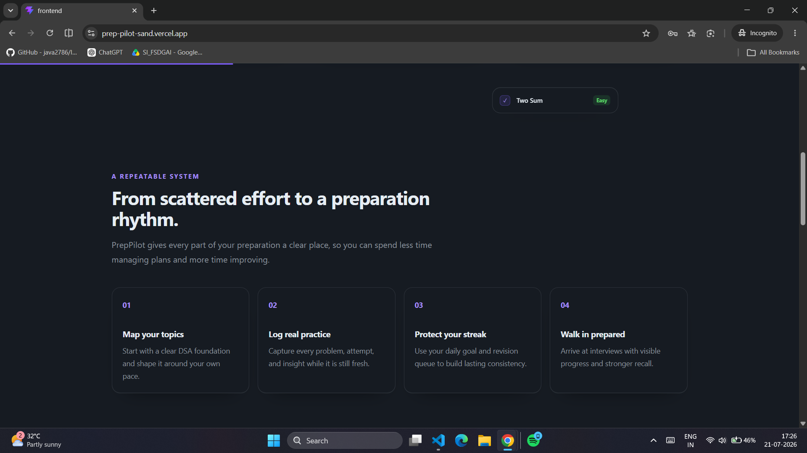
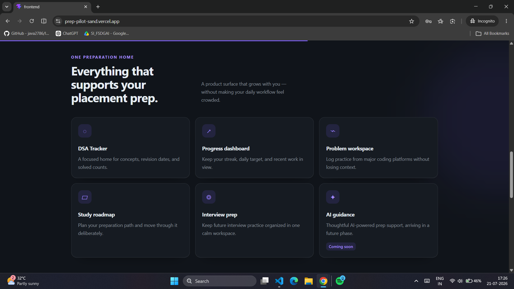
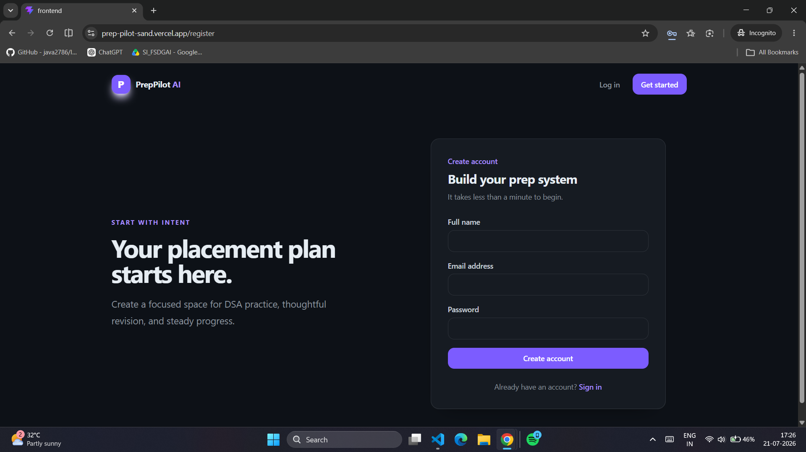
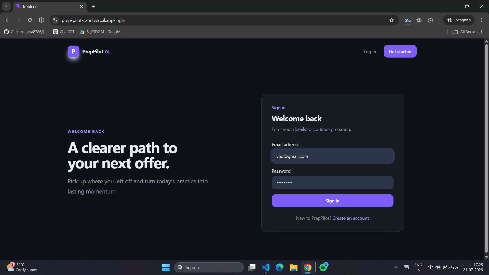
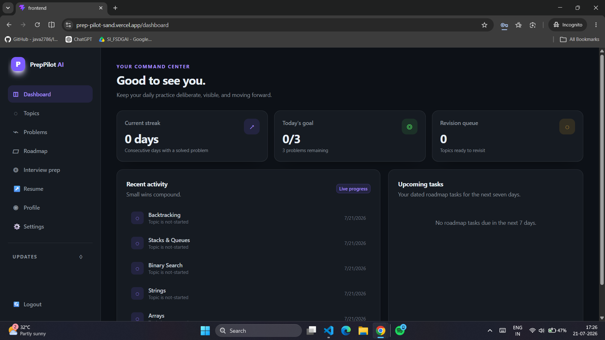
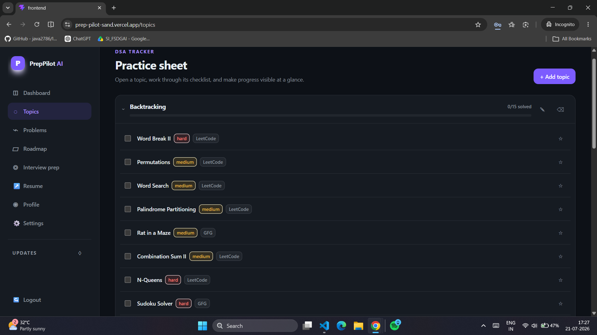
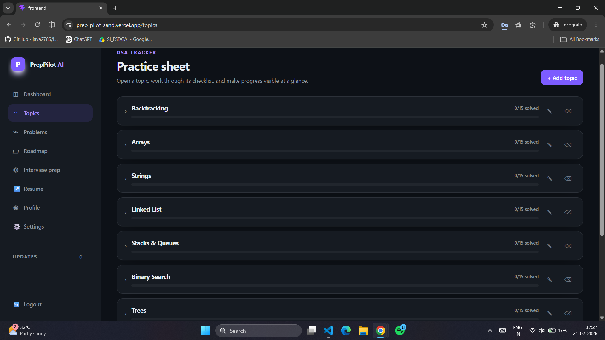
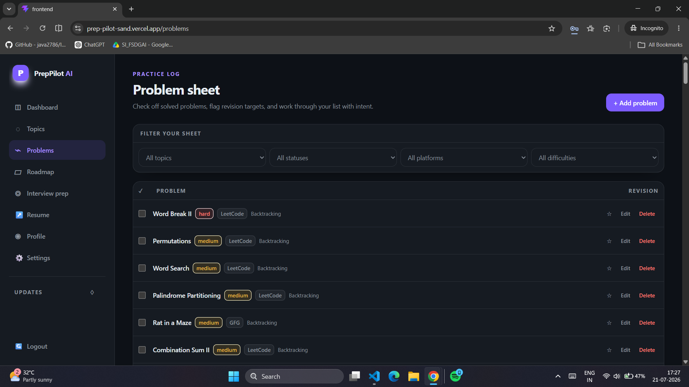
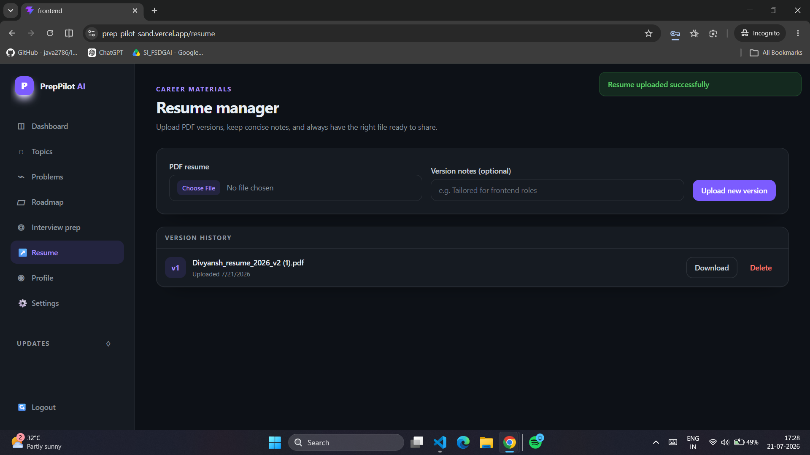

# PrepPilot


PrepPilot is a calmer, more focused system for serious placement preparation. It brings DSA practice, progress tracking, study planning, interview preparation, resume versions, and revision reminders into one workspace.

---

## Live Demo & Screenshots

> The backend is hosted on a free tier. If it has been inactive, the first load may take 30–50 seconds while the server starts up.

### Landing Page







---

### Authentication





---

### Dashboard



---

### Topic Tracker





---

### Problem Tracker



---

### Resume Manager



---

## Features

| Area | What it provides |
| --- | --- |
| Progress Dashboard | Current streak, daily goal, revision queue, recent activity, and dated roadmap tasks. |
| DSA Topic Tracker | Topic progress, revision dates, notes, solved counts, and expandable practice sheets. |
| Problem Workspace | Filterable problem checklist with solved status, difficulty/platform badges, and revision bookmarks. |
| Study Roadmap | Daily, weekly, and monthly plans with dated tasks and completion tracking. |
| Interview Prep | Technical, HR, and behavioral question bank with company filters, notes, confidence ratings, and practice status. |
| Resume Manager | Local PDF upload, per-user version history, authenticated downloads, and deletion. |
| Notifications | Revision-due reminders with unread state and mark-as-read controls. |
| AI Guidance | A future-facing product area reserved for thoughtful AI-powered prep support. |

### Current Capabilities

- [x] JWT-based registration, login, profile management, and protected routes
- [x] User-scoped Topics and Problems CRUD
- [x] Default DSA topics and practice problems for new accounts
- [x] Dashboard streaks, goals, revision tracking, and roadmap tasks
- [x] Roadmap, Interview Prep, Resume, and Notification modules
- [x] Responsive dark interface with motion-aware interactions

---

## Tech Stack

| Layer | Technologies |
| --- | --- |
| Frontend | React, Vite, Tailwind CSS, Framer Motion, Axios |
| Backend | Node.js, Express, Mongoose, Multer |
| Database | MongoDB Atlas |
| Authentication | JWT, bcryptjs |
| Validation | validator, custom Express middleware |

---

## Project Structure

```text
PrepPilot/
├── backend/
│   ├── src/
│   │   ├── controllers/
│   │   ├── middleware/
│   │   ├── models/
│   │   ├── routes/
│   │   └── utils/
│   └── uploads/
├── frontend/
│   └── src/
│       ├── components/
│       ├── pages/
│       ├── services/
│       └── context/
└── screenshots/
```

---

## Getting Started

### Prerequisites

- Node.js and npm
- A MongoDB Atlas connection string

### 1. Clone the repository

```bash
git clone https://github.com/gdivyansh960/PrepPilot.git
cd PrepPilot
```

### 2. Install dependencies

```bash
npm install
npm install --prefix backend
npm install --prefix frontend
```

### 3. Configure environment variables

Create local environment files from the included examples.

```bash
cp backend/.env.example backend/.env
cp frontend/.env.example frontend/.env
```

Configure the following values:

| File | Variable | Purpose |
| --- | --- | --- |
| `backend/.env` | `PORT` | Express server port. |
| `backend/.env` | `MONGO_URI` | MongoDB Atlas connection string. |
| `backend/.env` | `JWT_SECRET` | Strong secret used to sign authentication tokens. |
| `backend/.env` | `JWT_EXPIRES_IN` | Token lifetime, for example `7d`. |
| `frontend/.env` | `VITE_API_URL` | Backend API base URL, for example `http://localhost:5000/api`. |

### 4. Run the application

Run both applications from the project root:

```bash
npm run dev
```

Or start them separately:

```bash
cd backend
npm run dev
```

```bash
cd frontend
npm run dev
```

### Available Scripts

| Location | Command | Description |
| --- | --- | --- |
| Project root | `npm run dev` | Starts the backend and frontend concurrently. |
| `backend` | `npm run dev` | Starts Express with Nodemon. |
| `backend` | `npm start` | Starts Express with Node.js. |
| `frontend` | `npm run dev` | Starts the Vite development server. |
| `frontend` | `npm run build` | Creates a production frontend build. |
| `frontend` | `npm run lint` | Runs the frontend linter. |
