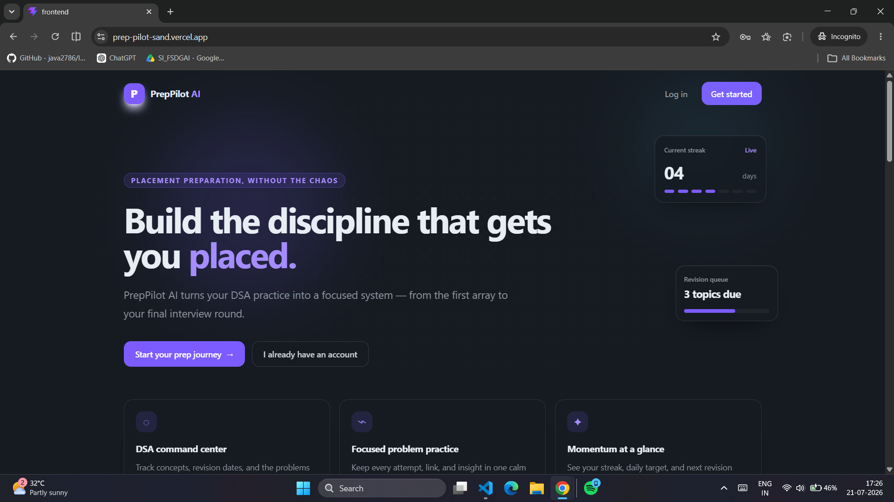
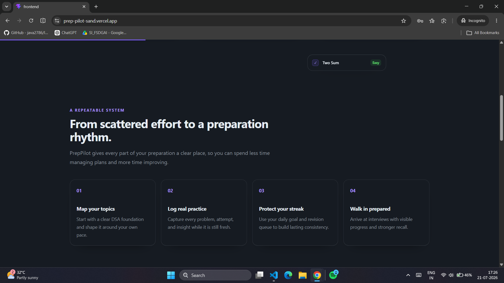
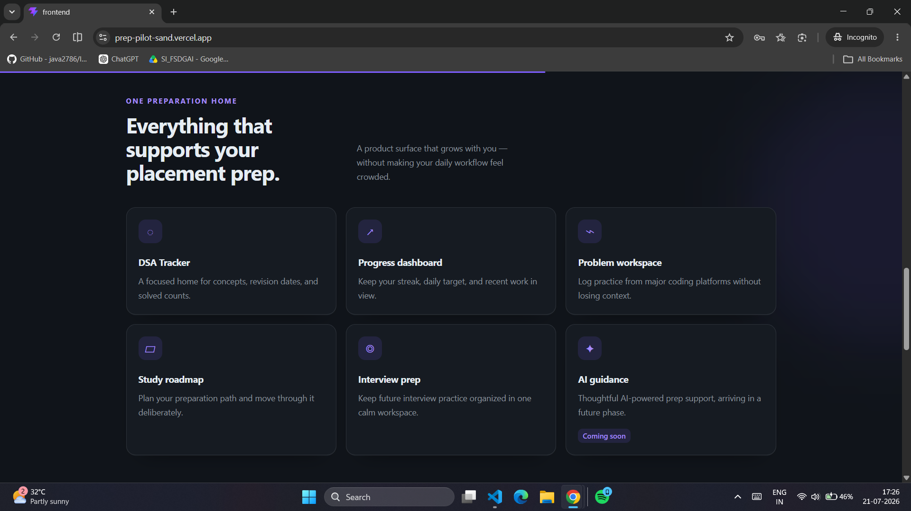
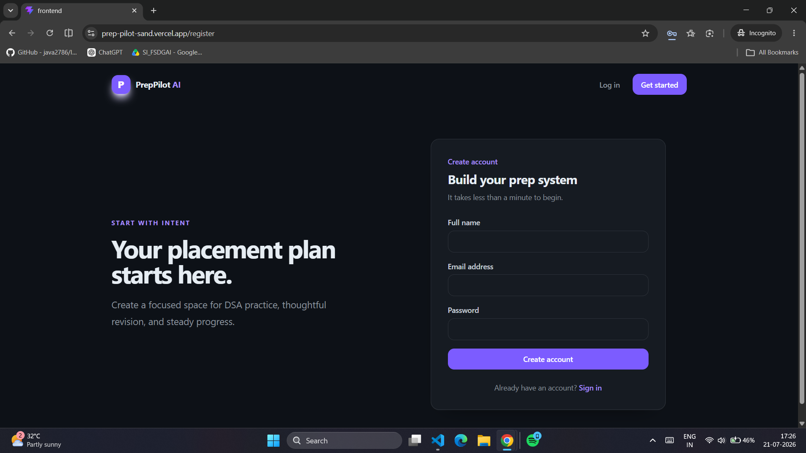
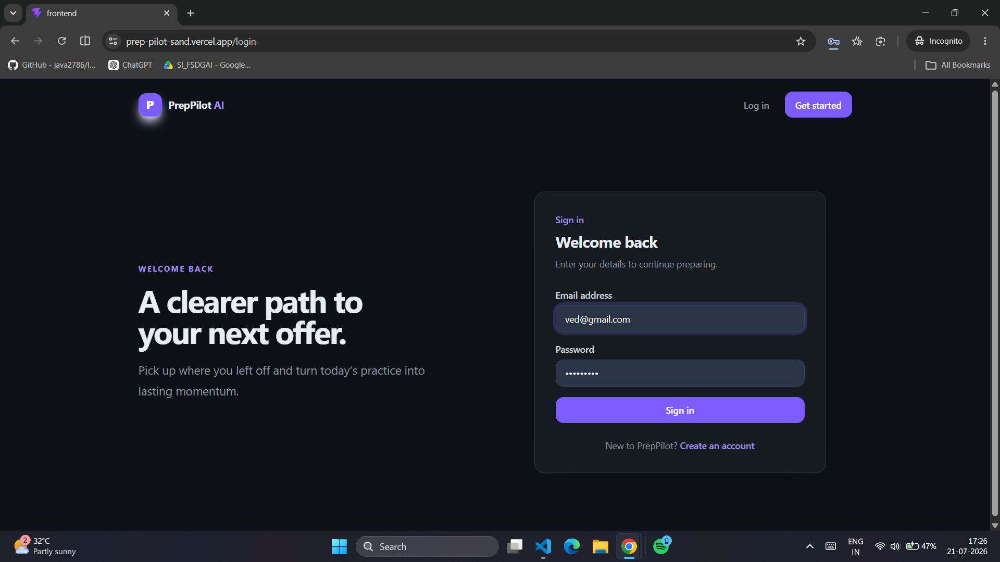
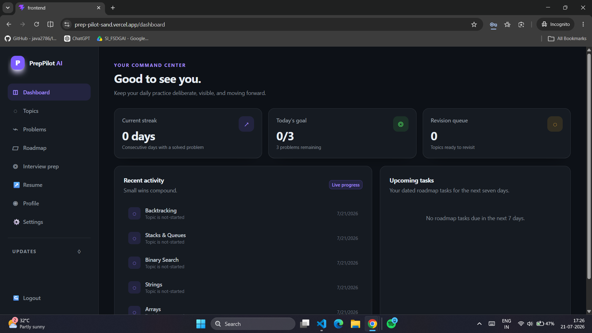
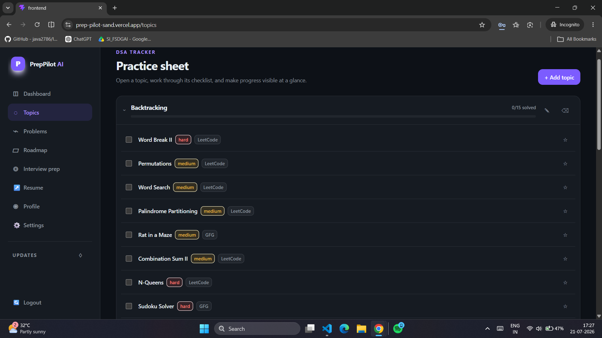
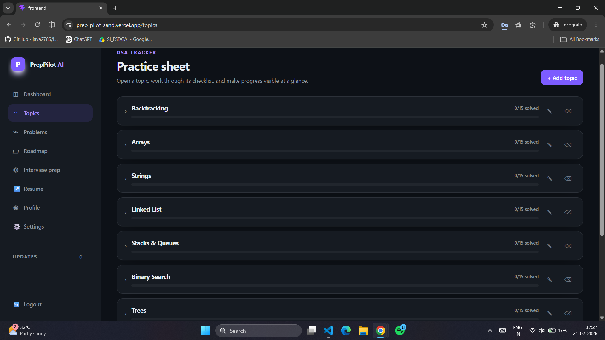
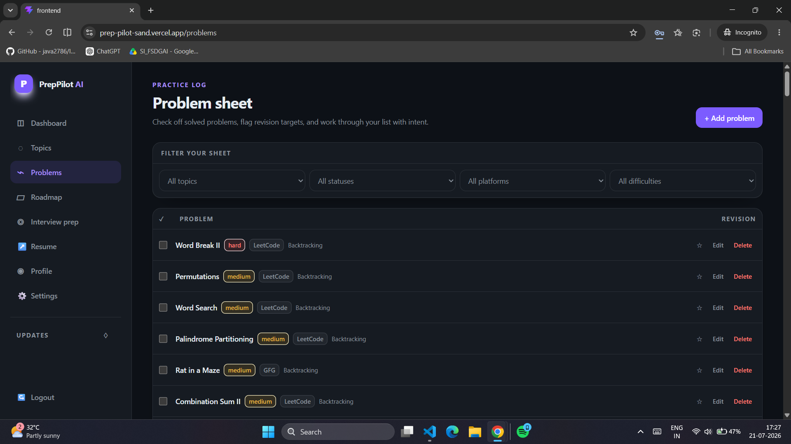
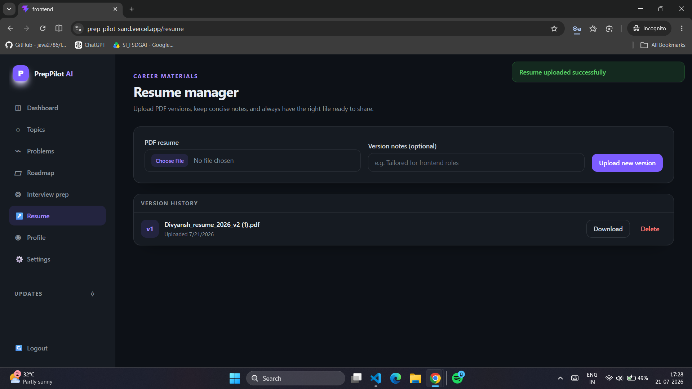

# PrepPilot AI

A calmer, more focused system for serious placement preparation.

## Live Demo & Screenshots

**Live App:** [https://prep-pilot-sand.vercel.app](https://prep-pilot-sand.vercel.app)

> **Note:** The backend is hosted on a free tier. If it has been inactive, the first load may take 30-50 seconds while the server starts up.







## Features

-   **Progress Dashboard:** Keep your streak, daily target, and recent work in view.
    

-   **DSA Topic Tracker:** A focused home for concepts, revision dates, and solved counts.
    
    

-   **Problem Workspace:** Log practice from major coding platforms without losing context.
    

-   **Resume Manager:** Upload and manage versions of your resume, ready for applications.
    

-   **Study Roadmap:** Plan your preparation path and move through it deliberately.

-   **Interview Prep:** Keep future interview practice organized in one calm workspace.

-   **AI Guidance:** Thoughtful AI-powered prep support, arriving in a future phase.

## Tech Stack

-   **Frontend:** React, Vite, Tailwind CSS, Framer Motion
-   **Backend:** Node.js, Express, MongoDB
-   **Authentication:** JWT (JSON Web Tokens)

## Getting Started

To run this project locally:

1.  Clone the repository:
    ```bash
    git clone https://github.com/your-username/preppilot.git
    ```
2.  Install backend dependencies:
    ```bash
    cd preppilot/backend
    npm install
    ```
3.  Install frontend dependencies:
    ```bash
    cd ../frontend
    npm install
    ```
4.  Create a `.env` file in the `backend` directory with your MongoDB connection string and JWT secret.
5.  Start the backend server:
    ```bash
    npm start
    ```
6.  Start the frontend development server:
    ```bash
    cd ../frontend
    npm run dev
    ```
